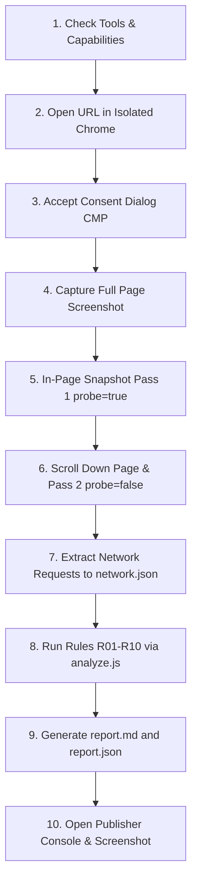

# Usage Guide — gpt-audit

`gpt-audit` automates technical audits of Google Publisher Tag (GPT / Google Ad Manager) implementations on live web pages. You interact with it by issuing natural language prompts to your AI coding agent (**Google Antigravity**, **Claude Code**, or **OpenAI Codex**), or by invoking the standalone CLI scripts directly in CI/CD.

---

## 1. Natural Language Prompts

Once the plugin is installed, you can prompt your agent in plain English. The agent recognizes the `gpt-audit` skill and orchestrates the browser, collector, analyzer, and reporter automatically.

### Single URL Audit
Audit a single website and generate a complete report:

```text
Audit the GPT setup on https://www.telegraph.co.uk/ and write the report to out/
```

*What the agent returns:*
- Report Header: Target URL, GPT version, defined slots count, ad requests count, consent summary, and findings count by severity.
- High-severity findings with recommended technical fixes.
- Path to `out/<host>/report.md`.

---

### Comparative Multi-URL Audit
Audit multiple URLs (e.g. comparing your property against benchmarks or staging vs production):

```text
Audit the GPT setup on https://www.telegraph.co.uk/ and https://edition.cnn.com/, compare their setups, and save reports to out/
```

*What the agent returns:*
- Individual report headers for each URL.
- The consolidated comparison matrix from `out/comparison.md` comparing slots, ad requests, SRA status, Prebid version, consent signals, unfilled slots, and anomaly counts.

---

### Specific Slot or CLS Troubleshooting
Target specific ad slots or layout shift investigations:

```text
Audit https://example.com/article and check why the top banner slot is causing layout shift or returning unfilled.
```

---

## 2. Antigravity Subagent (`@gpt-auditor`)

In Google Antigravity, `gpt-audit` also registers a background subagent:

```text
@gpt-auditor audit https://www.telegraph.co.uk/
```

The subagent executes the full audit pipeline asynchronously, freeing your conversation thread, and returns the report summary and file links upon completion.

---

## 3. The 10-Step Audit Procedure

When triggered, the agent executes the procedure defined in `skills/gpt-audit/SKILL.md`:



1. **Verify MCP Tools**: Validates `navigate_page`, `evaluate_script`, `list_network_requests`, `get_network_request`, `take_screenshot`.
2. **Navigate with Pre-Listeners**: Injects `init-listeners.js` as `initScript` before page scripts execute to guarantee initial `slotRequested` and `slotResponseReceived` events are recorded.
3. **Handle Consent (CMP)**: Automatically clicks "Accept all" if an IAB TCF / Sourcepoint / OneTrust banner appears.
4. **Screenshot**: Saves `out/<host>/page.png`.
5. **Initial Snapshot**: Runs `collectGpt({ probe: true })` inside page.
6. **Scroll & Settle**: Scrolls in 600 px increments to trigger lazy-loaded slots, then captures the final snapshot with probe events (`out/<host>/snapshot.json`).
7. **Network Harvest**: Calls `list_network_requests` and `get_network_request` for GAM ad calls (`gampad/ads`) and libraries (`gpt.js`, `pubads_impl`), saving verbatim tool output to `out/<host>/network-raw.txt`, then parses into `out/<host>/network.json`.
8. **Analyze**: Runs `analyze.js` applying rules R01–R10 to produce `out/<host>/findings.json`.
9. **Report**: Runs `report.js` to create `report.md` and `report.json` (and `comparison.md` if multiple URLs).
10. **Publisher Console**: Evaluates `googletag.openConsole()`, captures `out/<host>/console.png`.

---

## 4. Strict Safety Guardrails

`gpt-audit` strictly enforces safety guardrails (`rules/no-ad-interaction.md`):

> [!CAUTION]
> **Ad Fraud & Invalid Traffic Prevention**:
> - **Never Click or Interact with Ad Creatives**: The agent will NEVER click, hover, focus, or scroll-into-view any element inside a `google_ads_iframe_*` or ad container.
> - **Read-Only**: The agent never invokes `googletag.display()`, `pubads().refresh()`, or `destroySlots()` on live sites.
> - **Only One Page Load**: Exactly one page load per URL. No automated reloads or retries.
> - **CMP Only**: The only allowable click in an entire audit run is clicking "Accept" on the cookie consent banner.

---

## 5. Output Directory Structure

All generated audit data is stored in `out/<host>/` (git-ignored):

```text
out/
├── comparison.md                      # Multi-host comparison matrix (when auditing > 1 URL)
└── www.telegraph.co.uk/
    ├── snapshot.json                  # In-page pubads, slots, targeting, and events
    ├── network-raw.txt                # Verbatim MCP tool output from DevTools
    ├── network.json                   # Structured GAM requests (SRA, params, consent, kind)
    ├── findings.json                  # Output of rules R01-R16 (id, severity, slot, evidence, fix)
    ├── report.md                      # Human-readable Markdown audit report
    ├── report.json                    # Machine-readable JSON summary for CI/CD
    ├── report.html                    # Interactive visual HTML report with Hero, KPIs & health score
    ├── page.png                       # Initial viewport screenshot
    └── console.png                    # Google Publisher Console screenshot
```

---

## 6. Understanding the Report

### Slot Table & Fill Types
The Slot Table in `report.md` classifies ad fills into three clear categories:
- **Direct Line Item**: Filled by standard direct or sponsorship line items (displays numerical `lineItemId` and `creativeId`).
- **AdX / Open Bidding**: Programmatic Google Ad Exchange or Open Bidding fill. Displayed as `AdX/OB (<sourceAgnosticLineItemId>)` when `lineItemId` is null and `isBackfill: true`.
- **Unfilled**: Slot requested but no ad was returned (displays `unfilled`).

### Findings Grouped by Severity
- **High Severity**: Critical errors that prevent monetization, break user tracking, or violate privacy:
  - `[R01]` Slot defined but never requested or displayed.
  - `[R02]` Container div missing or duplicate IDs in DOM.
  - `[R07]` Mixed correlators in a single page view.
  - `[R08]` Initial load disabled with no refresh fallback.
  - `[R09]` GDPR consent mismatch or missing TC string.
- **Medium Severity**: Suboptimal setup, potential CLS, or unfilled inventory:
  - `[R03]` Unfilled ad slot.
  - `[R04]` No requested size fits the current viewport.
  - `[R05]` Container size differs from creative or missing `reservedHeight` (CLS risk).
  - `[R10]` Legacy host (`googletagservices.com`) or duplicate gpt.js tags.
- **Low Severity**: Architecture recommendations:
  - `[R06]` Single Request Architecture (SRA) disabled.
- **Publisher Compliance (High / Medium)**:
  - `[R16]` Publisher mandatory parameter missing (e.g. PPID omitted, required page targeting absent, required custom parameters missing in `cust_params`).

---

## 7. Publisher Mandatory Parameters (`gpt-audit.config.json`)

Publishers often enforce internal tagging policies and mandatory parameters ("Pflichtparameter") — such as requiring a **PPID (Publisher Provided Identifier)** on authenticated sessions, mandatory key-value targeting (e.g. `section`, `user_tier`), or specific slot names.

You can specify these rules in a `gpt-audit.config.json` file in your project root, or pass a custom config via `-c <config.json>`:

```json
{
  "$schema": "./gpt-audit.config.schema.json",
  "publisher": "Example Media Group",
  "required": {
    "ppid": true,
    "custParams": ["section", "user_tier"],
    "pageTargeting": ["env", "edition"],
    "slotTargeting": ["pos"],
    "minSlots": 1,
    "requireSra": false,
    "requireSafeFrame": false
  },
  "slots": {
    "requiredElementIds": ["top-leaderboard"]
  }
}
```

### Configurable Checks

| Field | Check Performed | Severity if Violated |
| :--- | :--- | :--- |
| `ppid: true` | Validates that all display ad requests to GAM contain a non-empty `ppid` parameter (`req.ppid === true`). | **High** (`R16`) |
| `custParams: [...]` | Checks that `req.cust_params` in display requests includes each specified key with non-empty values. | **High** (`R16`) |
| `pageTargeting: [...]` | Checks that `gpt.pageTargeting` contains each key (set via `googletag.pubads().setTargeting(...)`). | **High** (`R16`) |
| `slotTargeting: [...]` | Checks that each defined slot in `snapshot.slots` has the specified targeting keys. | **Medium** (`R16`) |
| `requiredElementIds: [...]` | Ensures specific slot container element IDs are registered on the page. | **High** (`R16`) |
| `minSlots: <number>` | Verifies that the total slot count meets or exceeds the required threshold. | **Medium** (`R16`) |
| `requireSafeFrame: true` | Verifies that all rendered creatives are served in SafeFrames. | **Medium** (`R16`) |

### Compliance Report Output
When a configuration file is active, `report.md` includes a dedicated compliance matrix:

```markdown
## 2. Publisher Mandatory Parameters (Compliance)

Configuration Profile: **Example Media Group** | Status: **COMPLIANT ✅**

| Requirement | Category | Status | Verification Evidence / Details |
| :--- | :--- | :--- | :--- |
| `PPID (Publisher Provided Identifier)` | Ad Request | ✅ Passed | Present across all 3 display ad request(s) |
| `cust_params: 'section'` | Ad Request | ✅ Passed | Present across all 3 display ad request(s) |
| `Page Targeting: 'env'` | Page Config | ✅ Passed | Configured: "production" |
| `Slot Targeting: 'pos'` | Slot Config | ✅ Passed | Present on all 4 slot(s) |
```

If any check fails, `analyze.js` automatically creates **High** or **Medium** severity `R16` findings detailing exactly which requests or slots failed and providing the exact JavaScript fix.

---

## 8. Standalone CLI Usage (Without an Agent / CI)

You can run the parsing, analysis, and reporting pipeline directly using Node.js without driving a browser:

```bash
# 1. Extract network data from raw tool dump
npm run extract -- out/www.telegraph.co.uk/network-raw.txt -o out/www.telegraph.co.uk/network.json

# 2. Run rule engine on collected snapshot and network data
npm run analyze -- out/www.telegraph.co.uk/snapshot.json out/www.telegraph.co.uk/network.json -o out/www.telegraph.co.uk/findings.json

# 3. Generate Markdown and JSON reports
npm run report -- out/www.telegraph.co.uk/snapshot.json out/www.telegraph.co.uk/network.json out/www.telegraph.co.uk/findings.json -o out/www.telegraph.co.uk/

# 4. Generate multi-host comparison matrix
node skills/gpt-audit/scripts/report.js --compare out/*/report.json -o out/comparison.md
```
